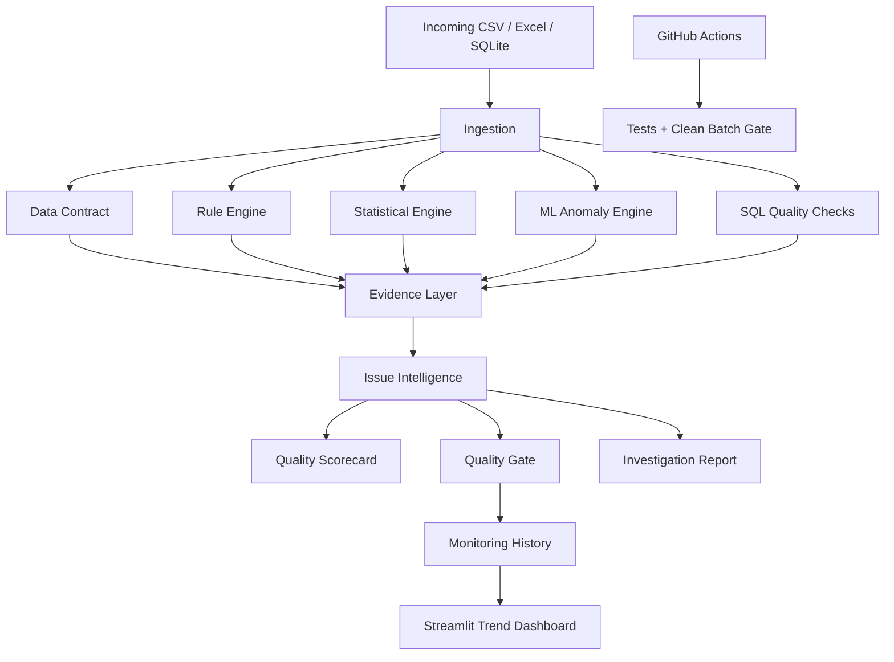

# Architecture

AI Data Quality Detective is organized as a layered quality-investigation pipeline.

## Design principles

1. **Deterministic checks remain deterministic.** A domain rule such as `discount ∈ [0, 1]` is not delegated to machine learning.
2. **Statistical and ML findings are signals.** A shift or anomaly is not automatically a data error. Business context is required before remediation.
3. **Evidence is preserved.** Findings include method, severity, affected records, and investigation context.
4. **Rules are configurable.** Data contracts and quality thresholds live outside the Python logic.
5. **The score is transparent.** The quality scorecard is explicitly project-specific rather than presented as an industry standard.
6. **The same analysis can be monitored over time.** Each batch can be persisted and compared with prior runs.
